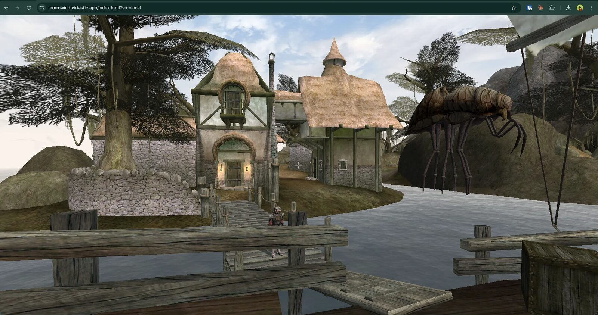

# OpenTES3

**One seamless public Morrowind world, in your browser.** The OpenMW engine, compiled to
WebAssembly, with a server that owns the world. By [Virtastic](https://virtastic.app).

  

  <a href="https://opentes3.com"><b>▶ Play at opentes3.com</b></a> ·
  <a href="https://discord.gg/PzFfDkbSue">Discord</a> ·
  <a href="https://www.youtube.com/@Virtastic-Apps">YouTube</a> ·
  <a href="https://github.com/Virtastic/openmw-web/issues">Issues</a> ·
  <a href="https://github.com/Virtastic/openmw-web/discussions">Discussions</a>

OpenTES3 (v2 of openmw-web, branch `OpenTES3`) is a WebAssembly build of
[OpenMW](https://openmw.org/), the open-source reimplementation of *The Elder Scrolls III:
Morrowind*, joined to one shared world that everyone plays in. The engine runs client-side in a
desktop browser - no plugins, no streaming service, and no game data included: you prove you
own Morrowind once and the server does the rest.

v1 (the single-player and self-hosted openmw-web at morrowind.virtastic.app) lives on `main`.

## Running the world (v2)

v2 is one hosted public world, deployed by us; there is no self-host installer (CL12). The
stack is [`docker-compose.yml`](docker-compose.yml) plus [`deploy/Caddyfile`](deploy/Caddyfile):
set `OPENMW_WEB_TAG` in `.env` to the release tag, then `docker compose pull && docker compose
up -d`. To roll back, set the previous tag and run the same two commands. Hand-run and
proxy details are in [`docs/ADVANCED.md`](docs/ADVANCED.md). Stuck? Ask in
[Discord](https://discord.gg/PzFfDkbSue).

## Playing

Open [opentes3.com](https://opentes3.com) in desktop Chrome and sign in with Google or
Discord - those are the only sign-ins, and accounts are keyed on the provider's stable ID,
never your email. The first time, upload `Morrowind.esm`, `Tribunal.esm` and `Bloodmoon.esm` as proof
that you own the game (Game of the Year edition); after that the server streams the game data to your browser, on any machine. Create a
character and you are in the world with everyone else.

Settings and keybindings persist in the browser; your character and progress live on the
server. In-game, **Options → Video** has a resolution-scale setting - drop it a notch on
lighter hardware.

### Troubleshooting

- **The ownership check refuses my file.** Upload the three `.esm` files from your own
  install's `Data Files` folder (Steam, GOG or disc); mods and edited masters are refused.
- **Stuck on loading.** Check the browser requirement below; Firefox, Safari and mobile do
  not work.

More help: [Discord](https://discord.gg/PzFfDkbSue).

## The world

There is one world and everyone is in it: no instances, no private servers, no world to
create. You can group up with friends, whisper, mute, block and report in-game.

The server owns the world: NPCs, combat resolution and loot are simulated server-side by a
headless copy of the engine, so a modified client cannot author what an NPC did.

## What's in this repo

A code-only repo - game assets, dependency caches and build outputs are gitignored.

| Path | Purpose |
|------|---------|
| `openmw/` | OpenMW engine source (upstream plus local WASM changes) |
| `play/` | Browser front-end: sign-in door, game page, dev server |
| `server/` | The server (TypeScript/Node): the world, SSO, the ownership check, admin |
| `wasm-build/` | Build scripts, patches and tooling for the WASM engine |
| `deploy/` | Container and reverse-proxy config |

The `openmw/` tree tracks upstream at the commit recorded in
[`.openmw-base-commit.txt`](.openmw-base-commit.txt); how the desktop engine was made to run
in a browser tab is written up in [`WASM_ADAPTATIONS.md`](WASM_ADAPTATIONS.md).

## Testing

- Server: `cd server && npm test` (TypeScript check plus the unit suite).
- Lua: `bash wasm-build/lua-tests/run.sh` (needs Docker).
- End to end: the multiplayer browser harness (`server/bots/`), run on the build server by
  the `openmw-web-dev` Jenkins job with `BRANCH=OpenTES3` - see [`AGENTS.md`](AGENTS.md).

See [`CHANGELOG.md`](CHANGELOG.md) for what changed.

## Building from source

Only needed if you are changing the engine itself. The
toolchain (Emscripten 6.0.1), the dependency stack, the wasm64 story and every hard-won
gotcha live in [`docs/BUILDING.md`](docs/BUILDING.md). Questions:
[Discord](https://discord.gg/PzFfDkbSue).

### Browser requirement

Desktop Chrome or Chromium with MEMORY64 (Chrome/Edge 133+): the engine needs
SharedArrayBuffer + threads, WebGL2 via ANGLE, `EXT_clip_control`, and the File System
Access API. Firefox, Safari and mobile are not supported.

## License

openmw-web is licensed under the GNU General Public License, version 3. It is a derivative
work of OpenMW, which is itself GPLv3, so the combined work is GPLv3. The full text is in
[`LICENSE`](LICENSE); bundled dependencies keep their own licenses (see
[`THIRD-PARTY-LICENSES.md`](THIRD-PARTY-LICENSES.md)).

### Game data and trademarks

*The Elder Scrolls* and *Morrowind* are trademarks of ZeniMax Media / Bethesda Softworks.
This project is not affiliated with, endorsed by, or associated with Bethesda or ZeniMax. No
Morrowind game data is included or distributed here; you must own and supply your own
legally-obtained copy. The engine is an independent, clean-room reimplementation (OpenMW)
and ships no Bethesda assets.

## Community

- **[Discord](https://discord.gg/PzFfDkbSue)** - the fastest place for help, screenshots,
  and news. Technical deep-dives welcome.
- **[YouTube (@Virtastic-Apps)](https://www.youtube.com/@Virtastic-Apps)** - demos, build
  logs, and other native-to-browser ports.
- **[Reddit (r/virtastic)](https://www.reddit.com/r/virtastic)** - releases and discussion.
- **[LinkedIn](https://www.linkedin.com/company/virtastic)** - company news.
- **[GitHub Discussions](https://github.com/Virtastic/openmw-web/discussions)** - longer
  questions and showcases.

Bugs and features go to [Issues](https://github.com/Virtastic/openmw-web/issues); pull
requests are welcome, see [`CONTRIBUTING.md`](CONTRIBUTING.md).

## Support the project

openmw-web is built and hosted by [Virtastic](https://virtastic.app). If you enjoy it, you
can support us on [Ko-fi](https://ko-fi.com/virtastic) or
[Patreon](https://patreon.com/virtastic) - it pays for the servers and the development time.
Nothing is behind a paywall: every mode is free to everyone, and no tier buys a feature.

## Credits

- WASM port, tooling, and hosting: © 2025–2026 [Virtastic](https://virtastic.app). See
  [`NOTICE`](NOTICE) and [`AUTHORS.md`](AUTHORS.md).
- OpenMW: the engine this is built on, by the [OpenMW team](https://openmw.org/).
- Demo world: the OpenMW Example Suite (CC-BY / CC-BY-SA) by DestinedToDie and contributors,
  plus the OpenMW template data files.
